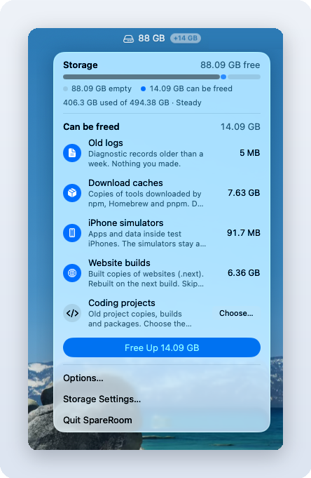
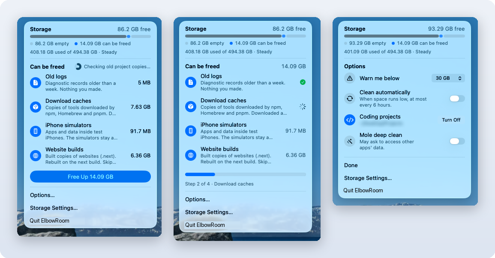

# SpareRoom

A tiny macOS menu bar app that shows how much disk space you have, how much more you could free, and frees it in one click. It only removes things that rebuild themselves or that hold no unsaved work.

<p align="center">
  
</p>

- The number is your free space. It turns **red** when you drop below your warning level (30 GB by default).
- The badge is how much more SpareRoom can free right now.
- Click it for a native glass panel with the details and a **Free Up** button.

## What the panel shows

<p align="center">
  
  <br><sub>Checking what can be freed · Cleaning, step by step · Options</sub>
</p>

- **Storage**: free space, a bar split into *used*, *can be freed* and *empty*, and a forecast such as "Filling about 12 GB a day, full in about 4 days".
- **Can be freed**: one row per kind of clutter, with its size and a one-line explanation. Click a row to include or skip it; SpareRoom remembers your choice. Rows with nothing to clean are hidden.
- **Free Up**: cleans the rows you have on, with a progress bar, a check mark per row, and a "Freed X GB" summary at the end.
- **Options**: warning level, clean automatically when space runs low, your coding projects folder, and an optional [Mole](https://github.com/tw93/Mole) deep clean.

## What it cleans

| Row | What is removed | Why it is safe | Skipped when |
|---|---|---|---|
| App caches | Files in `~/Library/Caches` not used for 7 days (Apple's own caches are left alone) | Apps rebuild caches | — |
| Old logs | Files in `~/Library/Logs` older than 7 days | Diagnostic records only | — |
| Download caches | npm, npx, Homebrew and pnpm caches | Downloaded again when needed | something is running from the npx cache |
| Xcode builds | `~/Library/Developer/Xcode/DerivedData` | Rebuilt on the next build. Archives are never touched | Xcode or a build is running |
| iPhone simulators | Apps and data inside simulators, plus simulators for iOS versions you no longer have | The simulators stay and start fresh | a simulator is running |
| Website builds | `.next` build folders in your projects and in GitHub Actions runner folders | Rebuilt on the next build | a process is running in that project (a dev server) |
| Packages in idle projects | `node_modules` in project copies (git worktrees) untouched for 7 days | `npm install` brings them back | something is running inside |
| Old project copies | Git worktrees with nothing left to keep (below) | All work is committed and pushed | see below |
| Mole deep clean (optional) | Whatever `mo clean` removes | Mole's own safety rules | off unless you turn it on |

### Old project copies (git worktrees)

Tools like Claude Code, Cursor and Codex create a git worktree per task, and each one can hold gigabytes of builds and packages. SpareRoom removes a worktree only when **all** of these are true:

- every change is committed, and the commit is on a remote branch (it runs `git fetch` first)
- no process is running inside it
- it has not changed in the last 4 hours
- no [Claude Code](https://claude.com/claude-code) conversation used it in the last 4 hours (read from `~/.claude/projects`, if you have it)
- it is not locked by a process that is still running

Only the extra working folder is removed. Branches and commits stay, and Claude Code keeps your conversation history.

## Permissions

SpareRoom asks for nothing by default. It does not read folders macOS protects, sends no notifications and makes no network requests of its own.

- **Your projects folder**: picked by you in a standard Open dialog. If it is in Desktop or Documents, macOS may ask once.
- **Mole deep clean** (off by default): Mole reads other apps' data folders, so macOS may ask for access.

## Install

Needs macOS 26 (Tahoe) or later and the Xcode command line tools (`xcode-select --install`).

```sh
git clone https://github.com/datasadeqist/SpareRoom.git
cd SpareRoom
make install      # builds SpareRoom.app into ~/Applications and opens it
make login        # optional: start it when you log in
```

`make` signs the app ad-hoc, which is all an app you build yourself needs. If you have a valid Apple Development certificate, `make install SIGN="Apple Development: Your Name (TEAMID)"` makes macOS remember the permissions you grant across rebuilds. Do not use a revoked certificate: macOS blocks apps signed with one as malware.

To remove it: `make uninstall`.

## How it works

- `Sources/SpareRoom.swift`: the app (AppKit + SwiftUI, one file).
- `Sources/cleanup.sh`: every cleanup step. `DRY=1` only measures and prints `@est <row> <KB>` lines, which the app shows as sizes.
- `Sources/sweep-worktrees.sh`: finds worktrees that are safe to remove. You can run it on its own:

  ```sh
  ROOT=~/Projects NO_FETCH=1 bash Sources/sweep-worktrees.sh          # preview
  ROOT=~/Projects bash Sources/sweep-worktrees.sh --apply             # remove
  ```

Each run writes its output to `~/Library/Logs/SpareRoom.log`.

## Acknowledgements

- [Mole](https://github.com/tw93/Mole) by [tw93](https://github.com/tw93): a disk cleaner for macOS whose cleanup categories inspired several of SpareRoom's. When you turn on *Mole deep clean* in Options and have Mole installed, SpareRoom runs its `mo clean` command. SpareRoom does not include or change any Mole code and works fully without it. Mole is a separate project under the GPL-3.0 license, and SpareRoom is not affiliated with it.

## License

MIT
